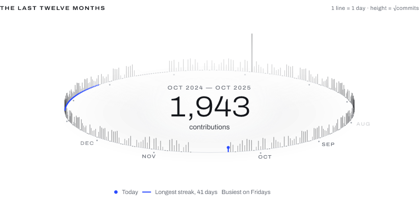

# Readmint

**Design your README. Any font, any data, any style.**

Readmint renders README graphics from designs you make yourself: your own layout, your own fonts, GIFs and
animation, bound to live data through placeholders — including a contribution calendar you can shape any way you like.
A GitHub Action in your own repository renders them as SVG, PNG, animated WebP, APNG or GIF and keeps them current.

<picture>
  <source media="(prefers-color-scheme: dark)" srcset="assets/readme/year-ring-dark.png">
  
</picture>

The _Year ring_ section of the Year Ring profile template, in its light and dark variant (your browser picks one). It is
a plain design in the public format, rendered by the same renderer as everything else, bound to the GitHub data of the
account the Action runs for. Status: early development.

## What it does

- **A design format of your own**: layers, groups, assets, animation, all in a versioned YAML or JSON file
  ([design format](docs/design-format.md), [renderer](docs/renderer.md)). Nothing is predefined: every built-in visual
  is a template in this format ([components and templates](docs/components.md)).
- **Data through placeholders**: GitHub first, private contributions through your own token, with safe expressions and
  no `eval` ([expressions](docs/expressions.md), [data sources](docs/data-sources.md),
  [GitHub data](docs/data-github.md)).
- **Your fonts**: bring your own; a font whose licence forbids embedding is never embedded
  ([fonts and licensing](docs/fonts.md)).
- **Outputs GitHub shows**: self-contained SVG without scripts or external references, or PNG, animated WebP, APNG and
  GIF ([output formats](docs/raster.md), [asset loading](docs/asset-loading.md)).
- **A GitHub Action** that renders in your repository on a schedule ([GitHub Action](docs/action.md)).
- **A visual editor and a CLI** that preview with the very same renderer, so the preview is the output
  ([editor](docs/editor.md), [CLI](docs/cli.md)).

## Quick start

1. Copy a design, with its fonts, from the [examples repository](https://github.com/MrLarkyy/readmint-template-test)
   (ready-to-copy workflows for the Year Ring, Horizon and Pinscreen profiles) or from the
   [starter templates](docs/components.md#starter-templates).
2. Save a workflow as `.github/workflows/readmint.yml`, with an exact release tag instead of `vX.Y.Z`:

   ```yaml
   name: Readmint
   on:
     schedule:
       - cron: "17 3 * * *"
     workflow_dispatch:
   permissions:
     contents: write
   concurrency:
     group: readmint
     cancel-in-progress: false
   jobs:
     render:
       runs-on: ubuntu-latest
       steps:
         - uses: actions/checkout@v7
         - uses: MrLarkyy/Readmint@vX.Y.Z
           with:
             designs: |
               readmint/designs/card.yaml
   ```

3. Run it once with _Run workflow_, and paste the `<picture>` snippet from the log group `README snippet` into your
   README.

Every input, the permissions and the errors are in the [GitHub Action](docs/action.md) page; the full path is in
[getting started](docs/getting-started.md), and [troubleshooting](docs/troubleshooting.md) lists what goes wrong.

## Documentation

The user guide is [the wiki](https://github.com/MrLarkyy/Readmint/wiki), generated from [`docs/`](docs)
([how it is published](docs/wiki-publishing.md)):

| start                                      | design                                                                                                                     | run                                                                                                    |
| ------------------------------------------ | -------------------------------------------------------------------------------------------------------------------------- | ------------------------------------------------------------------------------------------------------ |
| [Getting started](docs/getting-started.md) | [Design format](docs/design-format.md), [Expressions](docs/expressions.md), [Components and templates](docs/components.md) | [GitHub Action](docs/action.md), [CLI](docs/cli.md), [Editor](docs/editor.md)                          |
| [Troubleshooting](docs/troubleshooting.md) | [Fonts and licensing](docs/fonts.md), [Data sources](docs/data-sources.md), [GitHub data](docs/data-github.md)             | [Renderer](docs/renderer.md), [Output formats](docs/raster.md), [Asset loading](docs/asset-loading.md) |

Contributors: [golden tests](docs/golden-tests.md) and [wiki publishing](docs/wiki-publishing.md).

## Licence

Readmint is released under the [MIT licence](LICENSE). The fonts bundled with it keep their own licences (SIL Open
Font License), which sit next to the font files in their folders.

The Unicode tables in [`packages/fonts`](packages/fonts/LICENSE-UNICODE) and the CLDR locale tables in
[`packages/expr`](packages/expr/LICENSE-CLDR) are under the Unicode License v3.
